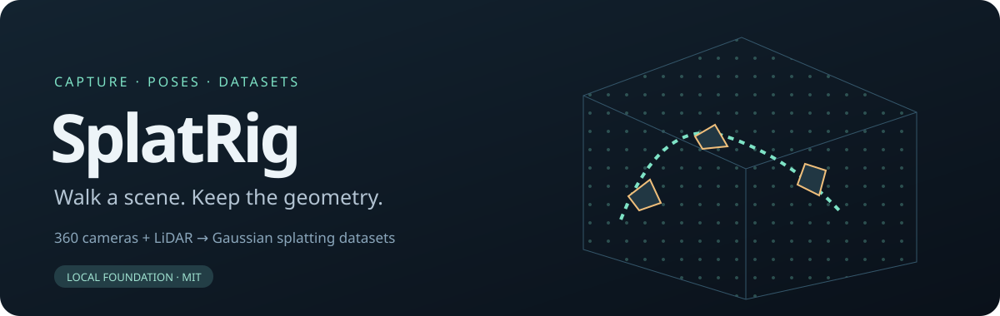
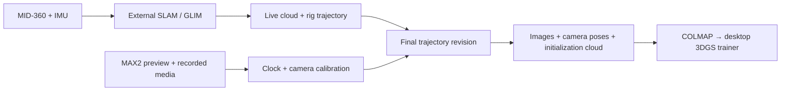

<p align="center"></p>

# SplatRig

**Walk a scene. Keep the geometry.**

360 cameras + LiDAR → pose-aware datasets for Gaussian splatting.

**English** | [繁體中文](README.zh-TW.md)

[Try the demo](#try-it-without-hardware) · [Data format](docs/FORMAT.md) · [Hardware](docs/HARDWARE.md) · [Roadmap](docs/ROADMAP.md) · [Contribute](CONTRIBUTING.md)

SplatRig is being built for a handheld GoPro MAX2 + Livox MID-360 rig: live point
clouds and camera trajectories while walking, then precisely associated images
and geometry for desktop 3DGS training.

**Current stage: local foundation.** Synthetic replay, clock fitting, pose
association, equirectangular-to-PINHOLE view conversion and COLMAP seed export
work now. A ROS 2 odometry recorder is included but has not been tested against
physical sensors. MAX2 acquisition, original .360 decoding, full SLAM integration
and indoor/outdoor validation are upcoming.

## Try it without hardware

Python 3.10+. The offline core uses only the standard library. No ROS, camera,
LiDAR, GPU or model download is needed.

From the repository root on Linux/macOS:

```sh
python3 -m venv .venv
source .venv/bin/activate
python -m pip install -e .
splatrig demo --output runs/demo
splatrig replay runs/demo --output runs/replay
splatrig export runs/demo --output runs/colmap
```

On Windows, activate the virtual environment with its Scripts/Activate.ps1
before running the same Python and splatrig commands.

Open **runs/replay/preview.html** in a browser. Orbit the point cloud, inspect
the camera route and toggle camera frustums. The preview is self-contained.
The fixture contains a rendered room, timestamped moving-sensor points and
known camera geometry. It is explicitly labeled synthetic, not a trained model.
The camera trajectory is supplied ground truth; no SLAM algorithm estimates it.

The exported dataset is:

```text
runs/colmap/
├── images/
├── sparse/0/             cameras.bin · images.bin · points3D.bin (+ text copies)
├── image-poses.jsonl     camera-to-world poses and source/reference timestamps
├── points.ply
├── report.json
└── preview.html
```

The sparse model supplies camera poses, PINHOLE intrinsics and initialization
points. It has no SfM observation tracks. A COLMAP-compatible trainer can consume
this layout; real capture quality and trainer-specific behavior still need testing.

## What the foundation does

- Fit clock offset and drift using paired physical-event timestamps.
- Interpolate rig poses and apply independent camera/LiDAR extrinsics.
- Replay every point at its own timestamp into a voxel-filtered cloud.
- Recompute cloud and photo poses from the same trajectory revision.
- Reject extrapolation, large pose gaps, mixed revisions and unfinished calibration.
- Export COLMAP binary/text seed models without changing captured inputs.
- Inspect captures in an offline browser preview with no external assets.

Ordinary export requires a final trajectory and calibrated rig/clock.
`--allow-provisional` explicitly produces diagnostic output and marks it as such.

## Capture architecture



The current executable entry point is the offline data boundary. Live SLAM runs
in a separate process. See the [hardware integration plan](docs/HARDWARE.md)
for which adapters exist and which still require implementation.

## Useful commands

```sh
splatrig validate runs/demo
splatrig fit-clock events.csv --output runs/clock.json
splatrig demo --panorama --output runs/panorama          # synthetic 360 input
splatrig panorama-views runs/panorama --output runs/views  # requires ffmpeg
splatrig record-poses --help
python -m unittest discover -s tests -v
python tools/smoke.py
python tools/check_project.py
```

Clock-event CSV columns are `camera_ns,reference_ns`; use at least three paired
measurements spanning the capture. Shared recording commands are not exposure
measurements. See [time and coordinates](docs/FORMAT.md).

## Build with us

The first hardware milestone is one reproducible indoor/outdoor capture with
original files, calibration, trajectory revisions and an independently checked
training export. The [roadmap](docs/ROADMAP.md) lists concrete acceptance checks.
Useful contributions include MAX2 stream/PTS characterization, recorded MID-360
fixtures and reproducible trainer-loader checks.

The [local test record](docs/LOCAL_TESTS.md) separates completed software checks
from device integration and training that have not run.

Project-specific development instructions are in [AGENTS.md](AGENTS.md), with a
repository skill under [.agents/skills/splatrig-development](.agents/skills/splatrig-development/SKILL.md).

## License and related work

MIT. See [LICENSE](LICENSE) and [NOTICE](NOTICE).

The workflow builds on the author's [AnyReplica](https://github.com/KuoFengYuan/anyreplica)
experience. SplatRig has its own implementation and license. External SLAM,
device drivers, camera software and trainers retain their own licenses.
