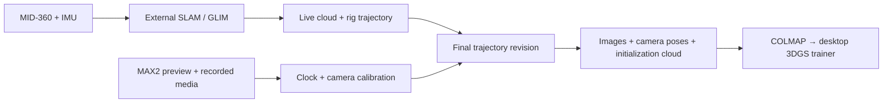

<p align="center"></p>

# SplatRig

**Walk a scene. Keep the geometry.**

360 cameras + LiDAR → pose-aware datasets for Gaussian splatting.

**English** | [繁體中文](README.zh-TW.md)

[Try the demo](#try-it-without-hardware) · [Data format](docs/FORMAT.md) · [Hardware](docs/HARDWARE.md) · [Roadmap](docs/ROADMAP.md) · [Contribute](CONTRIBUTING.md)

SplatRig is being built for a handheld GoPro MAX2 + Livox MID-360 rig: live point
clouds and camera trajectories while walking, then precisely associated images
and geometry for desktop 3DGS training.

**Current stage: first hardware version.** A live console shows the Mid-360S
cloud, the MAX2 preview and a live GLIM route and map, and records both devices.
Recorded captures are processed end to end (.360 decoding, GLIM trajectory, gyro
calibration of the camera mount, PINHOLE views, COLMAP seed) into a dataset that
stays marked provisional: the camera translation is still entered by hand and
accuracy is not yet measured. Indoor/outdoor validation and 3DGS training are next.

## Start a live capture

On the capture machine (Ubuntu 24.04 with ROS 2 Jazzy, the Livox driver and GLIM;
see [hardware](docs/HARDWARE.md#one-command-start)):

```sh
tools/splatrig-ros start
```

It checks the machine, starts the Livox driver unless one is running, starts the
console with live GLIM and opens http://127.0.0.1:8090/?view=map. Ctrl+C stops
everything it started. `tools/splatrig-ros doctor` only reports what is missing,
with the command that fixes it. One-time setup:

```sh
sudo tools/install-ptp-service <lidar-nic>   # LiDAR time sync as a service; doctor prints the NIC
tools/splatrig-app --install                 # "SplatRig" in the application menu
```

## Try it without hardware

Python 3.10+. The offline core uses only the standard library. No ROS, camera,
LiDAR, GPU or model download is needed.

From the repository root on Linux/macOS:

```sh
python3 -m venv .venv
source .venv/bin/activate
python -m pip install -e .
splatrig demo --output runs/demo
splatrig replay runs/demo --output runs/replay
splatrig export runs/demo --output runs/colmap
```

On Windows, activate the virtual environment with its Scripts/Activate.ps1
before running the same Python and splatrig commands.

Open **runs/replay/preview.html** in a browser. Orbit the point cloud, inspect
the camera route and toggle camera frustums. The preview is self-contained.
The fixture contains a rendered room, timestamped moving-sensor points and
known camera geometry. It is explicitly labeled synthetic, not a trained model.
The camera trajectory is supplied ground truth; no SLAM algorithm estimates it.

The exported dataset is:

```text
runs/colmap/
├── images/
├── sparse/0/             cameras.bin · images.bin · points3D.bin (+ text copies)
├── image-poses.jsonl     camera-to-world poses and source/reference timestamps
├── points.ply
├── report.json
└── preview.html
```

The sparse model supplies camera poses, PINHOLE intrinsics and initialization
points. It has no SfM observation tracks. A COLMAP-compatible trainer can consume
this layout; real capture quality and trainer-specific behavior still need testing.

## What the foundation does

- Fit clock offset and drift using paired physical-event timestamps.
- Interpolate rig poses and apply independent camera/LiDAR extrinsics.
- Replay every point at its own timestamp into a voxel-filtered cloud.
- Recompute cloud and photo poses from the same trajectory revision.
- Reject extrapolation, large pose gaps, mixed revisions and unfinished calibration.
- Export COLMAP binary/text seed models without changing captured inputs.
- Inspect captures in an offline browser preview with no external assets.

Ordinary export requires a final trajectory and calibrated rig/clock.
`--allow-provisional` explicitly produces diagnostic output and marks it as such.

## Capture architecture



The current executable entry point is the offline data boundary. Live SLAM runs
in a separate process. See the [hardware integration plan](docs/HARDWARE.md)
for which adapters exist and which still require implementation.

## Useful commands

```sh
splatrig validate runs/demo
splatrig fit-clock events.csv --output runs/clock.json
splatrig demo --panorama --output runs/panorama          # synthetic 360 input
splatrig panorama-views runs/panorama --output runs/views  # requires ffmpeg
splatrig import-livox <bag> --output runs/lidar            # requires ROS 2 + Livox driver
splatrig live                                              # local console, http://127.0.0.1:8090/
tools/splatrig-ros start                                   # checks + driver + console + GLIM
tools/splatrig-ros doctor                                  # what is missing on this machine
tools/splatrig-ros live --slam --calibration <calibration.json>   # console only, driver already running
splatrig glim-bag <bag> --output runs/glim                 # PointCloud2 copy for GLIM
tools/splatrig-ros calibrate-gyro <rotation capture> --output runs/mount-calibration
tools/splatrig-ros process-capture <capture> --output <run> --calibration runs/mount-calibration/calibration.json
splatrig record-poses --help
python -m unittest discover -s tests -v
python tools/smoke.py
python tools/check_project.py
```

Clock-event CSV columns are `camera_ns,reference_ns`; use at least three paired
measurements spanning the capture. Shared recording commands are not exposure
measurements. See [time and coordinates](docs/FORMAT.md).

## Build with us

The first hardware milestone is one reproducible indoor/outdoor capture with
original files, calibration, trajectory revisions and an independently checked
training export. The [roadmap](docs/ROADMAP.md) lists concrete acceptance checks.
Useful contributions include MAX2 stream/PTS characterization, recorded MID-360
fixtures and reproducible trainer-loader checks.

The [local test record](docs/LOCAL_TESTS.md) separates completed software checks
from device integration and training that have not run.

Project-specific development instructions are in [AGENTS.md](AGENTS.md), with a
repository skill under [.agents/skills/splatrig-development](.agents/skills/splatrig-development/SKILL.md).

## License and related work

MIT. See [LICENSE](LICENSE) and [NOTICE](NOTICE).

The workflow builds on the author's [AnyReplica](https://github.com/KuoFengYuan/anyreplica)
experience. SplatRig has its own implementation and license. External SLAM,
device drivers, camera software and trainers retain their own licenses.
