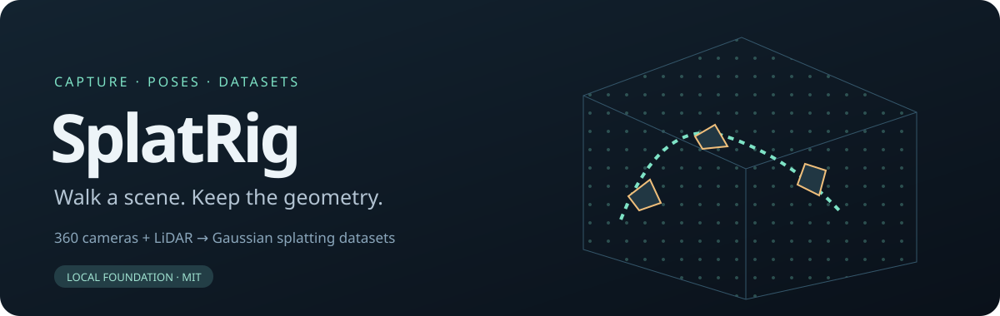

<p align="center"></p>

# SplatRig

[English](README.md) | **繁體中文**

用手持的 GoPro MAX2 + Livox Mid-360S 掃描場景，輸出 3DGS 可訓練的 COLMAP 資料集。
掃描時可即時看到點雲、路線與相機位置。

目前狀態：即時介面、錄製與離線處理都能用；相機平移量仍是手動輸入，輸出標示為暫定，
精度尚未量測。

文件：[硬體](docs/HARDWARE.zh-TW.md) · [資料格式](docs/FORMAT.zh-TW.md) · [開發路線](docs/ROADMAP.zh-TW.md) · [測試紀錄](docs/LOCAL_TESTS.zh-TW.md)

## 部署

Ubuntu 24.04。編譯前先 `conda deactivate`。

1. 安裝 [ROS 2 Jazzy](https://docs.ros.org/en/jazzy/Installation/Ubuntu-Install-Debs.html)，再裝：

   ```sh
   sudo apt install -y ros-jazzy-desktop ros-dev-tools linuxptp ffmpeg
   ```

2. Livox SDK2 與 driver：

   ```sh
   git clone https://github.com/Livox-SDK/Livox-SDK2.git ~/Livox-SDK2
   cd ~/Livox-SDK2 && mkdir build && cd build && cmake .. -DCMAKE_POLICY_VERSION_MINIMUM=3.5
   make -j"$(nproc)" && sudo make install && sudo ldconfig
   mkdir -p ~/ws_livox/src && git clone https://github.com/Livox-SDK/livox_ros_driver2.git ~/ws_livox/src/livox_ros_driver2
   ```

   修改 `config/MID360s_config.json`：`host_ip` 改成 `192.168.1.50`，`ip` 改成
   `192.168.1.1XX`（XX 為序號末兩碼）。然後編譯：

   ```sh
   source /opt/ros/jazzy/setup.bash && cd ~/ws_livox/src/livox_ros_driver2 && ./build.sh jazzy
   ```

3. GLIM：

   ```sh
   curl -s --compressed https://koide3.github.io/ppa/ubuntu2404/KEY.gpg | gpg --dearmor | sudo tee /etc/apt/trusted.gpg.d/koide3_ppa.gpg >/dev/null
   echo "deb [signed-by=/etc/apt/trusted.gpg.d/koide3_ppa.gpg] https://koide3.github.io/ppa/ubuntu2404 ./" | sudo tee /etc/apt/sources.list.d/koide3_ppa.list
   sudo apt update && sudo apt install -y libiridescence-dev libboost-all-dev libglfw3-dev libmetis-dev libgtsam-points-dev ros-jazzy-glim-ros
   ```

4. 網路（網卡名稱用 `ip -br link` 查）：

   ```sh
   sudo nmcli con add type ethernet ifname <lidar-nic> con-name livox ipv4.method manual \
     ipv4.addresses 192.168.1.50/24 ipv4.never-default yes ipv6.method disabled
   sudo nmcli con add type ethernet ifname <gopro-nic> con-name gopro ipv4.method auto \
     ipv4.never-default yes ipv6.method disabled
   ```

5. 下載本專案，設定 PTP 服務與選單捷徑：

   ```sh
   git clone <repository-url> splatrig && cd splatrig
   sudo tools/install-ptp-service <lidar-nic>
   tools/splatrig-app --install
   ```

## 使用

```sh
tools/splatrig-ros doctor   # 檢查環境，列出缺少的項目
tools/splatrig-ros start    # 啟動 driver、介面與 GLIM，開啟瀏覽器
```

也可以從應用程式選單點「SplatRig」。在網頁上按 Record 開始錄製，Ctrl+C 結束。

錄完後處理：

```sh
# 裝好設備後先做一次：拿著設備繞三個軸轉動約 30 秒並錄下來
tools/splatrig-ros calibrate-gyro ~/captures/<旋轉錄影> --output runs/calibration

tools/splatrig-ros process-capture ~/captures/<錄影> --output runs/<名稱> \
  --calibration runs/calibration/calibration.json --camera-offset 0 0 0.083
```

輸出資料夾是 COLMAP 格式（`images/`、`sparse/0/`、`points.ply`）。

## 沒有硬體時

```sh
python3 -m venv .venv && source .venv/bin/activate && pip install -e .
splatrig demo --output runs/demo
splatrig replay runs/demo --output runs/replay    # 用瀏覽器開 runs/replay/preview.html
splatrig export runs/demo --output runs/colmap
```

示範資料是合成的，只用來驗證軟體流程。

## 開發

```sh
python -m unittest discover -s tests -v
python tools/smoke.py
python tools/check_project.py
```

工作規範見 [AGENTS.md](AGENTS.zh-TW.md)。

## 授權

MIT，見 [LICENSE](LICENSE) 與 [NOTICE](NOTICE)。GLIM、Livox driver 等外部軟體依各自的授權。
