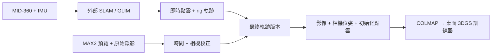

<p align="center"></p>

# SplatRig

**走過場景，留下可靠幾何。**

360 相機 + LiDAR → 具有一致相機位姿的 Gaussian splatting 訓練資料。

[English](README.md) | **繁體中文**

[執行示範](#不需要硬體的示範) · [資料格式](docs/FORMAT.zh-TW.md) · [硬體](docs/HARDWARE.zh-TW.md) · [開發路線](docs/ROADMAP.zh-TW.md) · [參與開發](CONTRIBUTING.zh-TW.md)

SplatRig 的目標是 GoPro MAX2 + Livox MID-360 手持掃描設備：邊走邊顯示點雲
與相機軌跡，再將影像與幾何精確配對，交給桌面 3DGS 訓練器。

**目前階段：本機基礎版本。** 已可執行合成資料重播、時鐘擬合、位姿配對、
equirectangular 轉 PINHOLE 視角與 COLMAP 種子模型匯出。已提供 ROS 2 里程計
記錄器，但尚未與實體感測器測試。MAX2 擷取、原始 .360 解碼、完整 SLAM 串接及
室內外驗證為後續工作。

## 不需要硬體的示範

需要 Python 3.10 以上。離線核心只使用標準函式庫，不需要 ROS、相機、
LiDAR、GPU 或下載模型。

在 Linux/macOS 的儲存庫根目錄執行：

```sh
python3 -m venv .venv
source .venv/bin/activate
python -m pip install -e .
splatrig demo --output runs/demo
splatrig replay runs/demo --output runs/replay
splatrig export runs/demo --output runs/colmap
```

Windows 請先使用虛擬環境的 Scripts/Activate.ps1 啟用環境，
再執行相同的 Python 與 splatrig 指令。

以瀏覽器開啟 **runs/replay/preview.html**，可旋轉點雲、檢查相機路線並切換
相機視錐顯示。預覽包含全部資料，不需要網路。測試資料包含繪製的房間影像、
移動感測器的逐點時間及已知相機幾何，明確標為合成資料，不是訓練後的模型。
相機軌跡是事先給定的正確答案，目前沒有透過 SLAM 演算法估計。

匯出資料如下：

```text
runs/colmap/
├── images/
├── sparse/0/             cameras.bin · images.bin · points3D.bin（及文字版）
├── image-poses.jsonl     camera-to-world 位姿、來源與參考時間
├── points.ply
├── report.json
└── preview.html
```

稀疏模型提供相機位姿、PINHOLE 內參與初始化點，不含 SfM 觀測軌跡。
支援 COLMAP 的訓練器可使用此資料結構；實際拍攝品質及各訓練器的行為仍需測試。

## 基礎版本已完成的功能

- 以成對實體事件時間擬合時鐘偏移與漂移。
- 插值 rig 位姿，分別套用相機與 LiDAR 外參。
- 以每個點自己的時間重播點雲，並進行體素減量。
- 使用同一版軌跡重新計算點雲與照片位姿。
- 拒絕外插、過大位姿間隔、混合版本與未完成的校正。
- 保留原始擷取資料，匯出 COLMAP 二進位／文字種子模型。
- 使用沒有外部素材依賴的離線瀏覽器預覽。

一般匯出需要最終軌跡，以及完成校正的 rig／時鐘。
`--allow-provisional` 明確啟用診斷輸出，結果會保留暫定狀態。

## 擷取架構



目前可執行的入口位於離線資料處理階段，即時 SLAM 由獨立程序執行。
[硬體整合計畫](docs/HARDWARE.zh-TW.md)列出已提供的介面及尚待實作的部分。

## 常用指令

```sh
splatrig validate runs/demo
splatrig fit-clock events.csv --output runs/clock.json
splatrig demo --panorama --output runs/panorama          # 合成 360 輸入
splatrig panorama-views runs/panorama --output runs/views  # 需要 ffmpeg
splatrig import-livox <bag> --output runs/lidar            # 需要 ROS 2 與 Livox 驅動
splatrig record-poses --help
python -m unittest discover -s tests -v
python tools/smoke.py
python tools/check_project.py
```

校時事件 CSV 欄位為 `camera_ns,reference_ns`，至少使用三組涵蓋拍攝期間的
成對量測。共同發送錄影指令不代表量到曝光時間，詳見[時間與座標](docs/FORMAT.zh-TW.md)。

## 一起開發

第一個硬體里程碑是一筆可重現的室內外連續掃描，包含原始資料、校正、
軌跡修正版本及獨立檢查過的訓練資料。[開發路線](docs/ROADMAP.zh-TW.md)
列出具體驗收方式。適合參與的工作包含 MAX2 串流／PTS 量測、
MID-360 記錄資料及可重現的訓練器載入檢查。

[本機測試紀錄](docs/LOCAL_TESTS.zh-TW.md)區分已完成的軟體檢查，
以及尚未執行的裝置整合與訓練。

專案工作規範請看 [AGENTS.md](AGENTS.zh-TW.md)，專用技能放在
[.agents/skills/splatrig-development](.agents/skills/splatrig-development/SKILL.md)。

## 授權與相關專案

MIT，請見 [LICENSE](LICENSE) 與 [NOTICE](NOTICE)。

工作流程延續作者的 [AnyReplica](https://github.com/KuoFengYuan/anyreplica)
經驗，SplatRig 採用獨立實作與授權。外部 SLAM、裝置驅動、相機軟體與
訓練器各自依其授權使用。
